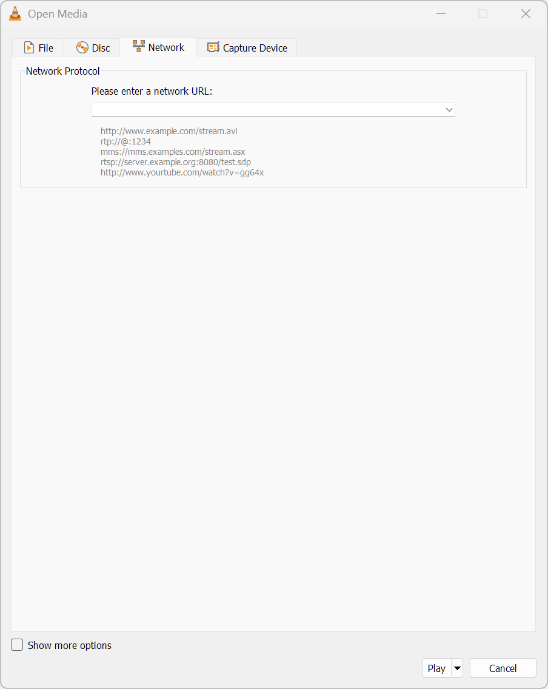

<!-- 🎨 2026 IPTV-ORG PLAYLIST DIRECTORY | Designed for GitHub Markdown -->
<a id="top"></a>
<h1 align="center">🌈📺 IPTV WORLD EXPLORER 🌍✨</h1>

<p align="center"><strong>🇦🇫 🇸🇪 🇮🇳 🇺🇸 🇯🇵 Discover public IPTV playlists around the globe 🎬</strong></p>

  

  

**🎨 A visual, easy-to-navigate guide to the official [IPTV-org](https://github.com/iptv-org/iptv) playlist directory.**

🗓️ **Directory snapshot:** 11 October 2026 &nbsp; • &nbsp; 🧬 **Source revision:** [`3914a407`](https://github.com/iptv-org/iptv/blob/3914a407afc720fc9c86a38e74bd5ffa2d77f92e/PLAYLISTS.md)

> [!IMPORTANT]
> 📡 **These are live playlist links, not offline TV files.** The source was checked on the date above, but channel availability changes; a listed stream may be broken, offline, geo-restricted, or unsupported by your player. “2026 edition” describes this directory snapshot, **not verification that each channel works in 2026**.

---

## 🚀 Start here — one click away

| 🧭 Explore | 🎞️ What it offers | 🔗 Ready-to-use playlist |
|:--|:--|:--|
| 🌏 **Every channel** | Official full channel directory | [🎬 Open all](https://iptv-org.github.io/iptv/index.m3u) |
| 🏳️ **Grouped by country** | One playlist, country-grouped | [🌍 Open countries](https://iptv-org.github.io/iptv/index.country.m3u) |
| 🧭 **Regions** | 42 geographic collections | [🗺️ Browse region playlists](#regions) |
| 💜 **Grouped by category** | News, sports, movies, etc. | [🎭 Open categories](https://iptv-org.github.io/iptv/index.category.m3u) |
| 🗣️ **Grouped by language** | Broadcast languages | [💬 Open languages](https://iptv-org.github.io/iptv/index.language.m3u) |

### 💖 Popular country shortcuts

| 🇸🇪 Sweden | 🇺🇸 United States | 🇬🇧 United Kingdom | 🇮🇳 India | 🇺🇦 Ukraine | 🇩🇪 Germany |
|:--:|:--:|:--:|:--:|:--:|:--:|
| [▶️ Watch](https://iptv-org.github.io/iptv/countries/se.m3u) | [▶️ Watch](https://iptv-org.github.io/iptv/countries/us.m3u) | [▶️ Watch](https://iptv-org.github.io/iptv/countries/uk.m3u) | [▶️ Watch](https://iptv-org.github.io/iptv/countries/in.m3u) | [▶️ Watch](https://iptv-org.github.io/iptv/countries/ua.m3u) | [▶️ Watch](https://iptv-org.github.io/iptv/countries/de.m3u) |

### 🧩 Jump to a section

**🌍 Countries:** [🇪🇺 Europe](#europe) · [🌏 Asia](#asia) · [🌍 Africa](#africa) · [🌎 North America & Caribbean](#north-america) · [🌎 South America](#south-america) · [🌊 Oceania](#oceania) · [🌐 Other](#other)

**🎛️ Other filters:** [🎭 Categories](#categories) · [🗣️ Languages](#languages) · [🗺️ Regions](#regions) · [🧰 How to use](#how-to-play) · [🛠️ Troubleshooting](#troubleshooting)

---

## 🌍 All country & territory playlists

Each **country/territory** links to its own official `.m3u`. Country assignments below are editorial navigation groupings; IPTV-org is the authority for which playlist URL belongs to each entry. **International** and **Undefined** are catalog groups, not countries.

<a id="europe"></a>
### 🇪🇺 Europe

  **🏰 Browse 46 country/territory entries.**

<details open>
<summary>📂 <strong>Show Europe playlists</strong> — 46 links</summary>

| 🏳️ Country / territory | 🎬 Playlist link | 🧾 File name |
|:--|:--:|:--|
| 🇦🇱 **Albania** | [▶️ Open .m3u](https://iptv-org.github.io/iptv/countries/al.m3u) | `al.m3u` |
| 🇦🇩 **Andorra** | [▶️ Open .m3u](https://iptv-org.github.io/iptv/countries/ad.m3u) | `ad.m3u` |
| 🇦🇹 **Austria** | [▶️ Open .m3u](https://iptv-org.github.io/iptv/countries/at.m3u) | `at.m3u` |
| 🇧🇾 **Belarus** | [▶️ Open .m3u](https://iptv-org.github.io/iptv/countries/by.m3u) | `by.m3u` |
| 🇧🇪 **Belgium** | [▶️ Open .m3u](https://iptv-org.github.io/iptv/countries/be.m3u) | `be.m3u` |
| 🇧🇦 **Bosnia and Herzegovina** | [▶️ Open .m3u](https://iptv-org.github.io/iptv/countries/ba.m3u) | `ba.m3u` |
| 🇧🇬 **Bulgaria** | [▶️ Open .m3u](https://iptv-org.github.io/iptv/countries/bg.m3u) | `bg.m3u` |
| 🇭🇷 **Croatia** | [▶️ Open .m3u](https://iptv-org.github.io/iptv/countries/hr.m3u) | `hr.m3u` |
| 🇨🇿 **Czech Republic** | [▶️ Open .m3u](https://iptv-org.github.io/iptv/countries/cz.m3u) | `cz.m3u` |
| 🇩🇰 **Denmark** | [▶️ Open .m3u](https://iptv-org.github.io/iptv/countries/dk.m3u) | `dk.m3u` |
| 🇪🇪 **Estonia** | [▶️ Open .m3u](https://iptv-org.github.io/iptv/countries/ee.m3u) | `ee.m3u` |
| 🇫🇮 **Finland** | [▶️ Open .m3u](https://iptv-org.github.io/iptv/countries/fi.m3u) | `fi.m3u` |
| 🇫🇷 **France** | [▶️ Open .m3u](https://iptv-org.github.io/iptv/countries/fr.m3u) | `fr.m3u` |
| 🇩🇪 **Germany** | [▶️ Open .m3u](https://iptv-org.github.io/iptv/countries/de.m3u) | `de.m3u` |
| 🇬🇷 **Greece** | [▶️ Open .m3u](https://iptv-org.github.io/iptv/countries/gr.m3u) | `gr.m3u` |
| 🇬🇬 **Guernsey** | [▶️ Open .m3u](https://iptv-org.github.io/iptv/countries/gg.m3u) | `gg.m3u` |
| 🇭🇺 **Hungary** | [▶️ Open .m3u](https://iptv-org.github.io/iptv/countries/hu.m3u) | `hu.m3u` |
| 🇮🇸 **Iceland** | [▶️ Open .m3u](https://iptv-org.github.io/iptv/countries/is.m3u) | `is.m3u` |
| 🇮🇪 **Ireland** | [▶️ Open .m3u](https://iptv-org.github.io/iptv/countries/ie.m3u) | `ie.m3u` |
| 🇮🇹 **Italy** | [▶️ Open .m3u](https://iptv-org.github.io/iptv/countries/it.m3u) | `it.m3u` |
| 🇽🇰 **Kosovo** | [▶️ Open .m3u](https://iptv-org.github.io/iptv/countries/xk.m3u) | `xk.m3u` |
| 🇱🇻 **Latvia** | [▶️ Open .m3u](https://iptv-org.github.io/iptv/countries/lv.m3u) | `lv.m3u` |
| 🇱🇮 **Liechtenstein** | [▶️ Open .m3u](https://iptv-org.github.io/iptv/countries/li.m3u) | `li.m3u` |
| 🇱🇹 **Lithuania** | [▶️ Open .m3u](https://iptv-org.github.io/iptv/countries/lt.m3u) | `lt.m3u` |
| 🇱🇺 **Luxembourg** | [▶️ Open .m3u](https://iptv-org.github.io/iptv/countries/lu.m3u) | `lu.m3u` |
| 🇲🇹 **Malta** | [▶️ Open .m3u](https://iptv-org.github.io/iptv/countries/mt.m3u) | `mt.m3u` |
| 🇲🇩 **Moldova** | [▶️ Open .m3u](https://iptv-org.github.io/iptv/countries/md.m3u) | `md.m3u` |
| 🇲🇨 **Monaco** | [▶️ Open .m3u](https://iptv-org.github.io/iptv/countries/mc.m3u) | `mc.m3u` |
| 🇲🇪 **Montenegro** | [▶️ Open .m3u](https://iptv-org.github.io/iptv/countries/me.m3u) | `me.m3u` |
| 🇳🇱 **Netherlands** | [▶️ Open .m3u](https://iptv-org.github.io/iptv/countries/nl.m3u) | `nl.m3u` |
| 🇲🇰 **North Macedonia** | [▶️ Open .m3u](https://iptv-org.github.io/iptv/countries/mk.m3u) | `mk.m3u` |
| 🇳🇴 **Norway** | [▶️ Open .m3u](https://iptv-org.github.io/iptv/countries/no.m3u) | `no.m3u` |
| 🇵🇱 **Poland** | [▶️ Open .m3u](https://iptv-org.github.io/iptv/countries/pl.m3u) | `pl.m3u` |
| 🇵🇹 **Portugal** | [▶️ Open .m3u](https://iptv-org.github.io/iptv/countries/pt.m3u) | `pt.m3u` |
| 🇷🇴 **Romania** | [▶️ Open .m3u](https://iptv-org.github.io/iptv/countries/ro.m3u) | `ro.m3u` |
| 🇷🇺 **Russia** | [▶️ Open .m3u](https://iptv-org.github.io/iptv/countries/ru.m3u) | `ru.m3u` |
| 🇸🇲 **San Marino** | [▶️ Open .m3u](https://iptv-org.github.io/iptv/countries/sm.m3u) | `sm.m3u` |
| 🇷🇸 **Serbia** | [▶️ Open .m3u](https://iptv-org.github.io/iptv/countries/rs.m3u) | `rs.m3u` |
| 🇸🇰 **Slovakia** | [▶️ Open .m3u](https://iptv-org.github.io/iptv/countries/sk.m3u) | `sk.m3u` |
| 🇸🇮 **Slovenia** | [▶️ Open .m3u](https://iptv-org.github.io/iptv/countries/si.m3u) | `si.m3u` |
| 🇪🇸 **Spain** | [▶️ Open .m3u](https://iptv-org.github.io/iptv/countries/es.m3u) | `es.m3u` |
| 🇸🇪 **Sweden** | [▶️ Open .m3u](https://iptv-org.github.io/iptv/countries/se.m3u) | `se.m3u` |
| 🇨🇭 **Switzerland** | [▶️ Open .m3u](https://iptv-org.github.io/iptv/countries/ch.m3u) | `ch.m3u` |
| 🇺🇦 **Ukraine** | [▶️ Open .m3u](https://iptv-org.github.io/iptv/countries/ua.m3u) | `ua.m3u` |
| 🇬🇧 **United Kingdom** | [▶️ Open .m3u](https://iptv-org.github.io/iptv/countries/uk.m3u) | `uk.m3u` |
| 🇻🇦 **Vatican City** | [▶️ Open .m3u](https://iptv-org.github.io/iptv/countries/va.m3u) | `va.m3u` |

</details>

[⬆️ Back to top](#top)

---

<a id="asia"></a>
### 🌏 Asia

  **🏯 Browse 50 country/territory entries.**

<details open>
<summary>📂 <strong>Show Asia playlists</strong> — 50 links</summary>

| 🏳️ Country / territory | 🎬 Playlist link | 🧾 File name |
|:--|:--:|:--|
| 🇦🇫 **Afghanistan** | [▶️ Open .m3u](https://iptv-org.github.io/iptv/countries/af.m3u) | `af.m3u` |
| 🇦🇲 **Armenia** | [▶️ Open .m3u](https://iptv-org.github.io/iptv/countries/am.m3u) | `am.m3u` |
| 🇦🇿 **Azerbaijan** | [▶️ Open .m3u](https://iptv-org.github.io/iptv/countries/az.m3u) | `az.m3u` |
| 🇧🇭 **Bahrain** | [▶️ Open .m3u](https://iptv-org.github.io/iptv/countries/bh.m3u) | `bh.m3u` |
| 🇧🇩 **Bangladesh** | [▶️ Open .m3u](https://iptv-org.github.io/iptv/countries/bd.m3u) | `bd.m3u` |
| 🇧🇹 **Bhutan** | [▶️ Open .m3u](https://iptv-org.github.io/iptv/countries/bt.m3u) | `bt.m3u` |
| 🇧🇳 **Brunei** | [▶️ Open .m3u](https://iptv-org.github.io/iptv/countries/bn.m3u) | `bn.m3u` |
| 🇰🇭 **Cambodia** | [▶️ Open .m3u](https://iptv-org.github.io/iptv/countries/kh.m3u) | `kh.m3u` |
| 🇨🇳 **China** | [▶️ Open .m3u](https://iptv-org.github.io/iptv/countries/cn.m3u) | `cn.m3u` |
| 🇨🇾 **Cyprus** | [▶️ Open .m3u](https://iptv-org.github.io/iptv/countries/cy.m3u) | `cy.m3u` |
| 🇬🇪 **Georgia** | [▶️ Open .m3u](https://iptv-org.github.io/iptv/countries/ge.m3u) | `ge.m3u` |
| 🇭🇰 **Hong Kong** | [▶️ Open .m3u](https://iptv-org.github.io/iptv/countries/hk.m3u) | `hk.m3u` |
| 🇮🇳 **India** | [▶️ Open .m3u](https://iptv-org.github.io/iptv/countries/in.m3u) | `in.m3u` |
| 🇮🇩 **Indonesia** | [▶️ Open .m3u](https://iptv-org.github.io/iptv/countries/id.m3u) | `id.m3u` |
| 🇮🇷 **Iran** | [▶️ Open .m3u](https://iptv-org.github.io/iptv/countries/ir.m3u) | `ir.m3u` |
| 🇮🇶 **Iraq** | [▶️ Open .m3u](https://iptv-org.github.io/iptv/countries/iq.m3u) | `iq.m3u` |
| 🇮🇱 **Israel** | [▶️ Open .m3u](https://iptv-org.github.io/iptv/countries/il.m3u) | `il.m3u` |
| 🇯🇵 **Japan** | [▶️ Open .m3u](https://iptv-org.github.io/iptv/countries/jp.m3u) | `jp.m3u` |
| 🇯🇴 **Jordan** | [▶️ Open .m3u](https://iptv-org.github.io/iptv/countries/jo.m3u) | `jo.m3u` |
| 🇰🇿 **Kazakhstan** | [▶️ Open .m3u](https://iptv-org.github.io/iptv/countries/kz.m3u) | `kz.m3u` |
| 🇰🇼 **Kuwait** | [▶️ Open .m3u](https://iptv-org.github.io/iptv/countries/kw.m3u) | `kw.m3u` |
| 🇰🇬 **Kyrgyzstan** | [▶️ Open .m3u](https://iptv-org.github.io/iptv/countries/kg.m3u) | `kg.m3u` |
| 🇱🇦 **Laos** | [▶️ Open .m3u](https://iptv-org.github.io/iptv/countries/la.m3u) | `la.m3u` |
| 🇱🇧 **Lebanon** | [▶️ Open .m3u](https://iptv-org.github.io/iptv/countries/lb.m3u) | `lb.m3u` |
| 🇲🇴 **Macao** | [▶️ Open .m3u](https://iptv-org.github.io/iptv/countries/mo.m3u) | `mo.m3u` |
| 🇲🇾 **Malaysia** | [▶️ Open .m3u](https://iptv-org.github.io/iptv/countries/my.m3u) | `my.m3u` |
| 🇲🇻 **Maldives** | [▶️ Open .m3u](https://iptv-org.github.io/iptv/countries/mv.m3u) | `mv.m3u` |
| 🇲🇳 **Mongolia** | [▶️ Open .m3u](https://iptv-org.github.io/iptv/countries/mn.m3u) | `mn.m3u` |
| 🇲🇲 **Myanmar** | [▶️ Open .m3u](https://iptv-org.github.io/iptv/countries/mm.m3u) | `mm.m3u` |
| 🇳🇵 **Nepal** | [▶️ Open .m3u](https://iptv-org.github.io/iptv/countries/np.m3u) | `np.m3u` |
| 🇰🇵 **North Korea** | [▶️ Open .m3u](https://iptv-org.github.io/iptv/countries/kp.m3u) | `kp.m3u` |
| 🇴🇲 **Oman** | [▶️ Open .m3u](https://iptv-org.github.io/iptv/countries/om.m3u) | `om.m3u` |
| 🇵🇰 **Pakistan** | [▶️ Open .m3u](https://iptv-org.github.io/iptv/countries/pk.m3u) | `pk.m3u` |
| 🇵🇸 **Palestine** | [▶️ Open .m3u](https://iptv-org.github.io/iptv/countries/ps.m3u) | `ps.m3u` |
| 🇵🇭 **Philippines** | [▶️ Open .m3u](https://iptv-org.github.io/iptv/countries/ph.m3u) | `ph.m3u` |
| 🇶🇦 **Qatar** | [▶️ Open .m3u](https://iptv-org.github.io/iptv/countries/qa.m3u) | `qa.m3u` |
| 🇸🇦 **Saudi Arabia** | [▶️ Open .m3u](https://iptv-org.github.io/iptv/countries/sa.m3u) | `sa.m3u` |
| 🇸🇬 **Singapore** | [▶️ Open .m3u](https://iptv-org.github.io/iptv/countries/sg.m3u) | `sg.m3u` |
| 🇰🇷 **South Korea** | [▶️ Open .m3u](https://iptv-org.github.io/iptv/countries/kr.m3u) | `kr.m3u` |
| 🇱🇰 **Sri Lanka** | [▶️ Open .m3u](https://iptv-org.github.io/iptv/countries/lk.m3u) | `lk.m3u` |
| 🇸🇾 **Syria** | [▶️ Open .m3u](https://iptv-org.github.io/iptv/countries/sy.m3u) | `sy.m3u` |
| 🇹🇼 **Taiwan** | [▶️ Open .m3u](https://iptv-org.github.io/iptv/countries/tw.m3u) | `tw.m3u` |
| 🇹🇯 **Tajikistan** | [▶️ Open .m3u](https://iptv-org.github.io/iptv/countries/tj.m3u) | `tj.m3u` |
| 🇹🇭 **Thailand** | [▶️ Open .m3u](https://iptv-org.github.io/iptv/countries/th.m3u) | `th.m3u` |
| 🇹🇷 **Turkiye** | [▶️ Open .m3u](https://iptv-org.github.io/iptv/countries/tr.m3u) | `tr.m3u` |
| 🇹🇲 **Turkmenistan** | [▶️ Open .m3u](https://iptv-org.github.io/iptv/countries/tm.m3u) | `tm.m3u` |
| 🇦🇪 **United Arab Emirates** | [▶️ Open .m3u](https://iptv-org.github.io/iptv/countries/ae.m3u) | `ae.m3u` |
| 🇺🇿 **Uzbekistan** | [▶️ Open .m3u](https://iptv-org.github.io/iptv/countries/uz.m3u) | `uz.m3u` |
| 🇻🇳 **Vietnam** | [▶️ Open .m3u](https://iptv-org.github.io/iptv/countries/vn.m3u) | `vn.m3u` |
| 🇾🇪 **Yemen** | [▶️ Open .m3u](https://iptv-org.github.io/iptv/countries/ye.m3u) | `ye.m3u` |

</details>

[⬆️ Back to top](#top)

---

<a id="africa"></a>
### 🌍 Africa

  **🦁 Browse 42 country/territory entries.**

<details open>
<summary>📂 <strong>Show Africa playlists</strong> — 42 links</summary>

| 🏳️ Country / territory | 🎬 Playlist link | 🧾 File name |
|:--|:--:|:--|
| 🇩🇿 **Algeria** | [▶️ Open .m3u](https://iptv-org.github.io/iptv/countries/dz.m3u) | `dz.m3u` |
| 🇦🇴 **Angola** | [▶️ Open .m3u](https://iptv-org.github.io/iptv/countries/ao.m3u) | `ao.m3u` |
| 🇧🇯 **Benin** | [▶️ Open .m3u](https://iptv-org.github.io/iptv/countries/bj.m3u) | `bj.m3u` |
| 🇧🇫 **Burkina Faso** | [▶️ Open .m3u](https://iptv-org.github.io/iptv/countries/bf.m3u) | `bf.m3u` |
| 🇨🇲 **Cameroon** | [▶️ Open .m3u](https://iptv-org.github.io/iptv/countries/cm.m3u) | `cm.m3u` |
| 🇨🇻 **Cape Verde** | [▶️ Open .m3u](https://iptv-org.github.io/iptv/countries/cv.m3u) | `cv.m3u` |
| 🇹🇩 **Chad** | [▶️ Open .m3u](https://iptv-org.github.io/iptv/countries/td.m3u) | `td.m3u` |
| 🇰🇲 **Comoros** | [▶️ Open .m3u](https://iptv-org.github.io/iptv/countries/km.m3u) | `km.m3u` |
| 🇨🇩 **Democratic Republic of the Congo** | [▶️ Open .m3u](https://iptv-org.github.io/iptv/countries/cd.m3u) | `cd.m3u` |
| 🇪🇬 **Egypt** | [▶️ Open .m3u](https://iptv-org.github.io/iptv/countries/eg.m3u) | `eg.m3u` |
| 🇬🇶 **Equatorial Guinea** | [▶️ Open .m3u](https://iptv-org.github.io/iptv/countries/gq.m3u) | `gq.m3u` |
| 🇪🇷 **Eritrea** | [▶️ Open .m3u](https://iptv-org.github.io/iptv/countries/er.m3u) | `er.m3u` |
| 🇪🇹 **Ethiopia** | [▶️ Open .m3u](https://iptv-org.github.io/iptv/countries/et.m3u) | `et.m3u` |
| 🇬🇲 **Gambia** | [▶️ Open .m3u](https://iptv-org.github.io/iptv/countries/gm.m3u) | `gm.m3u` |
| 🇬🇭 **Ghana** | [▶️ Open .m3u](https://iptv-org.github.io/iptv/countries/gh.m3u) | `gh.m3u` |
| 🇬🇳 **Guinea** | [▶️ Open .m3u](https://iptv-org.github.io/iptv/countries/gn.m3u) | `gn.m3u` |
| 🇨🇮 **Ivory Coast** | [▶️ Open .m3u](https://iptv-org.github.io/iptv/countries/ci.m3u) | `ci.m3u` |
| 🇰🇪 **Kenya** | [▶️ Open .m3u](https://iptv-org.github.io/iptv/countries/ke.m3u) | `ke.m3u` |
| 🇱🇾 **Libya** | [▶️ Open .m3u](https://iptv-org.github.io/iptv/countries/ly.m3u) | `ly.m3u` |
| 🇲🇬 **Madagascar** | [▶️ Open .m3u](https://iptv-org.github.io/iptv/countries/mg.m3u) | `mg.m3u` |
| 🇲🇱 **Mali** | [▶️ Open .m3u](https://iptv-org.github.io/iptv/countries/ml.m3u) | `ml.m3u` |
| 🇲🇷 **Mauritania** | [▶️ Open .m3u](https://iptv-org.github.io/iptv/countries/mr.m3u) | `mr.m3u` |
| 🇲🇺 **Mauritius** | [▶️ Open .m3u](https://iptv-org.github.io/iptv/countries/mu.m3u) | `mu.m3u` |
| 🇲🇦 **Morocco** | [▶️ Open .m3u](https://iptv-org.github.io/iptv/countries/ma.m3u) | `ma.m3u` |
| 🇲🇿 **Mozambique** | [▶️ Open .m3u](https://iptv-org.github.io/iptv/countries/mz.m3u) | `mz.m3u` |
| 🇳🇦 **Namibia** | [▶️ Open .m3u](https://iptv-org.github.io/iptv/countries/na.m3u) | `na.m3u` |
| 🇳🇪 **Niger** | [▶️ Open .m3u](https://iptv-org.github.io/iptv/countries/ne.m3u) | `ne.m3u` |
| 🇳🇬 **Nigeria** | [▶️ Open .m3u](https://iptv-org.github.io/iptv/countries/ng.m3u) | `ng.m3u` |
| 🇨🇬 **Republic of the Congo** | [▶️ Open .m3u](https://iptv-org.github.io/iptv/countries/cg.m3u) | `cg.m3u` |
| 🇷🇪 **Reunion** | [▶️ Open .m3u](https://iptv-org.github.io/iptv/countries/re.m3u) | `re.m3u` |
| 🇷🇼 **Rwanda** | [▶️ Open .m3u](https://iptv-org.github.io/iptv/countries/rw.m3u) | `rw.m3u` |
| 🇸🇳 **Senegal** | [▶️ Open .m3u](https://iptv-org.github.io/iptv/countries/sn.m3u) | `sn.m3u` |
| 🇸🇱 **Sierra Leone** | [▶️ Open .m3u](https://iptv-org.github.io/iptv/countries/sl.m3u) | `sl.m3u` |
| 🇸🇴 **Somalia** | [▶️ Open .m3u](https://iptv-org.github.io/iptv/countries/so.m3u) | `so.m3u` |
| 🇿🇦 **South Africa** | [▶️ Open .m3u](https://iptv-org.github.io/iptv/countries/za.m3u) | `za.m3u` |
| 🇸🇩 **Sudan** | [▶️ Open .m3u](https://iptv-org.github.io/iptv/countries/sd.m3u) | `sd.m3u` |
| 🇹🇿 **Tanzania** | [▶️ Open .m3u](https://iptv-org.github.io/iptv/countries/tz.m3u) | `tz.m3u` |
| 🇹🇬 **Togo** | [▶️ Open .m3u](https://iptv-org.github.io/iptv/countries/tg.m3u) | `tg.m3u` |
| 🇹🇳 **Tunisia** | [▶️ Open .m3u](https://iptv-org.github.io/iptv/countries/tn.m3u) | `tn.m3u` |
| 🇺🇬 **Uganda** | [▶️ Open .m3u](https://iptv-org.github.io/iptv/countries/ug.m3u) | `ug.m3u` |
| 🇪🇭 **Western Sahara** | [▶️ Open .m3u](https://iptv-org.github.io/iptv/countries/eh.m3u) | `eh.m3u` |
| 🇿🇼 **Zimbabwe** | [▶️ Open .m3u](https://iptv-org.github.io/iptv/countries/zw.m3u) | `zw.m3u` |

</details>

[⬆️ Back to top](#top)

---

<a id="north-america"></a>
### 🌎 North America & Caribbean

  **🏝️ Browse 29 country/territory entries.**

<details open>
<summary>📂 <strong>Show North America & Caribbean playlists</strong> — 29 links</summary>

| 🏳️ Country / territory | 🎬 Playlist link | 🧾 File name |
|:--|:--:|:--|
| 🇦🇬 **Antigua and Barbuda** | [▶️ Open .m3u](https://iptv-org.github.io/iptv/countries/ag.m3u) | `ag.m3u` |
| 🇦🇼 **Aruba** | [▶️ Open .m3u](https://iptv-org.github.io/iptv/countries/aw.m3u) | `aw.m3u` |
| 🇧🇸 **Bahamas** | [▶️ Open .m3u](https://iptv-org.github.io/iptv/countries/bs.m3u) | `bs.m3u` |
| 🇧🇧 **Barbados** | [▶️ Open .m3u](https://iptv-org.github.io/iptv/countries/bb.m3u) | `bb.m3u` |
| 🇧🇿 **Belize** | [▶️ Open .m3u](https://iptv-org.github.io/iptv/countries/bz.m3u) | `bz.m3u` |
| 🇧🇶 **Bonaire** | [▶️ Open .m3u](https://iptv-org.github.io/iptv/countries/bq.m3u) | `bq.m3u` |
| 🇻🇬 **British Virgin Islands** | [▶️ Open .m3u](https://iptv-org.github.io/iptv/countries/vg.m3u) | `vg.m3u` |
| 🇨🇦 **Canada** | [▶️ Open .m3u](https://iptv-org.github.io/iptv/countries/ca.m3u) | `ca.m3u` |
| 🇨🇷 **Costa Rica** | [▶️ Open .m3u](https://iptv-org.github.io/iptv/countries/cr.m3u) | `cr.m3u` |
| 🇨🇺 **Cuba** | [▶️ Open .m3u](https://iptv-org.github.io/iptv/countries/cu.m3u) | `cu.m3u` |
| 🇨🇼 **Curacao** | [▶️ Open .m3u](https://iptv-org.github.io/iptv/countries/cw.m3u) | `cw.m3u` |
| 🇩🇴 **Dominican Republic** | [▶️ Open .m3u](https://iptv-org.github.io/iptv/countries/do.m3u) | `do.m3u` |
| 🇸🇻 **El Salvador** | [▶️ Open .m3u](https://iptv-org.github.io/iptv/countries/sv.m3u) | `sv.m3u` |
| 🇬🇵 **Guadeloupe** | [▶️ Open .m3u](https://iptv-org.github.io/iptv/countries/gp.m3u) | `gp.m3u` |
| 🇬🇹 **Guatemala** | [▶️ Open .m3u](https://iptv-org.github.io/iptv/countries/gt.m3u) | `gt.m3u` |
| 🇭🇹 **Haiti** | [▶️ Open .m3u](https://iptv-org.github.io/iptv/countries/ht.m3u) | `ht.m3u` |
| 🇭🇳 **Honduras** | [▶️ Open .m3u](https://iptv-org.github.io/iptv/countries/hn.m3u) | `hn.m3u` |
| 🇯🇲 **Jamaica** | [▶️ Open .m3u](https://iptv-org.github.io/iptv/countries/jm.m3u) | `jm.m3u` |
| 🇲🇶 **Martinique** | [▶️ Open .m3u](https://iptv-org.github.io/iptv/countries/mq.m3u) | `mq.m3u` |
| 🇲🇽 **Mexico** | [▶️ Open .m3u](https://iptv-org.github.io/iptv/countries/mx.m3u) | `mx.m3u` |
| 🇳🇮 **Nicaragua** | [▶️ Open .m3u](https://iptv-org.github.io/iptv/countries/ni.m3u) | `ni.m3u` |
| 🇵🇦 **Panama** | [▶️ Open .m3u](https://iptv-org.github.io/iptv/countries/pa.m3u) | `pa.m3u` |
| 🇵🇷 **Puerto Rico** | [▶️ Open .m3u](https://iptv-org.github.io/iptv/countries/pr.m3u) | `pr.m3u` |
| 🇰🇳 **Saint Kitts and Nevis** | [▶️ Open .m3u](https://iptv-org.github.io/iptv/countries/kn.m3u) | `kn.m3u` |
| 🇱🇨 **Saint Lucia** | [▶️ Open .m3u](https://iptv-org.github.io/iptv/countries/lc.m3u) | `lc.m3u` |
| 🇻🇨 **Saint Vincent and the Grenadines** | [▶️ Open .m3u](https://iptv-org.github.io/iptv/countries/vc.m3u) | `vc.m3u` |
| 🇸🇽 **Sint Maarten** | [▶️ Open .m3u](https://iptv-org.github.io/iptv/countries/sx.m3u) | `sx.m3u` |
| 🇹🇹 **Trinidad and Tobago** | [▶️ Open .m3u](https://iptv-org.github.io/iptv/countries/tt.m3u) | `tt.m3u` |
| 🇺🇸 **United States** | [▶️ Open .m3u](https://iptv-org.github.io/iptv/countries/us.m3u) | `us.m3u` |

</details>

[⬆️ Back to top](#top)

---

<a id="south-america"></a>
### 🌎 South America

  **🦜 Browse 13 country/territory entries.**

<details open>
<summary>📂 <strong>Show South America playlists</strong> — 13 links</summary>

| 🏳️ Country / territory | 🎬 Playlist link | 🧾 File name |
|:--|:--:|:--|
| 🇦🇷 **Argentina** | [▶️ Open .m3u](https://iptv-org.github.io/iptv/countries/ar.m3u) | `ar.m3u` |
| 🇧🇴 **Bolivia** | [▶️ Open .m3u](https://iptv-org.github.io/iptv/countries/bo.m3u) | `bo.m3u` |
| 🇧🇷 **Brazil** | [▶️ Open .m3u](https://iptv-org.github.io/iptv/countries/br.m3u) | `br.m3u` |
| 🇨🇱 **Chile** | [▶️ Open .m3u](https://iptv-org.github.io/iptv/countries/cl.m3u) | `cl.m3u` |
| 🇨🇴 **Colombia** | [▶️ Open .m3u](https://iptv-org.github.io/iptv/countries/co.m3u) | `co.m3u` |
| 🇪🇨 **Ecuador** | [▶️ Open .m3u](https://iptv-org.github.io/iptv/countries/ec.m3u) | `ec.m3u` |
| 🇬🇫 **French Guiana** | [▶️ Open .m3u](https://iptv-org.github.io/iptv/countries/gf.m3u) | `gf.m3u` |
| 🇬🇾 **Guyana** | [▶️ Open .m3u](https://iptv-org.github.io/iptv/countries/gy.m3u) | `gy.m3u` |
| 🇵🇾 **Paraguay** | [▶️ Open .m3u](https://iptv-org.github.io/iptv/countries/py.m3u) | `py.m3u` |
| 🇵🇪 **Peru** | [▶️ Open .m3u](https://iptv-org.github.io/iptv/countries/pe.m3u) | `pe.m3u` |
| 🇸🇷 **Suriname** | [▶️ Open .m3u](https://iptv-org.github.io/iptv/countries/sr.m3u) | `sr.m3u` |
| 🇺🇾 **Uruguay** | [▶️ Open .m3u](https://iptv-org.github.io/iptv/countries/uy.m3u) | `uy.m3u` |
| 🇻🇪 **Venezuela** | [▶️ Open .m3u](https://iptv-org.github.io/iptv/countries/ve.m3u) | `ve.m3u` |

</details>

[⬆️ Back to top](#top)

---

<a id="oceania"></a>
### 🌊 Oceania

  **🐚 Browse 7 country/territory entries.**

<details open>
<summary>📂 <strong>Show Oceania playlists</strong> — 7 links</summary>

| 🏳️ Country / territory | 🎬 Playlist link | 🧾 File name |
|:--|:--:|:--|
| 🇦🇺 **Australia** | [▶️ Open .m3u](https://iptv-org.github.io/iptv/countries/au.m3u) | `au.m3u` |
| 🇵🇫 **French Polynesia** | [▶️ Open .m3u](https://iptv-org.github.io/iptv/countries/pf.m3u) | `pf.m3u` |
| 🇬🇺 **Guam** | [▶️ Open .m3u](https://iptv-org.github.io/iptv/countries/gu.m3u) | `gu.m3u` |
| 🇳🇨 **New Caledonia** | [▶️ Open .m3u](https://iptv-org.github.io/iptv/countries/nc.m3u) | `nc.m3u` |
| 🇳🇿 **New Zealand** | [▶️ Open .m3u](https://iptv-org.github.io/iptv/countries/nz.m3u) | `nz.m3u` |
| 🇵🇬 **Papua New Guinea** | [▶️ Open .m3u](https://iptv-org.github.io/iptv/countries/pg.m3u) | `pg.m3u` |
| 🇼🇸 **Samoa** | [▶️ Open .m3u](https://iptv-org.github.io/iptv/countries/ws.m3u) | `ws.m3u` |

</details>

[⬆️ Back to top](#top)

---

<a id="other"></a>
### 🌐 International & undefined

| 🏷️ Group | 📺 Playlist |
|:--|:--|
| 🌐 **International** | [📥 Open .m3u](https://iptv-org.github.io/iptv/countries/int.m3u) |
| ❔ **Undefined** | [📥 Open .m3u](https://iptv-org.github.io/iptv/countries/undefined.m3u) |

> 💡 **Tip:** For province/state and city playlists, visit the [official country + subdivision directory](https://github.com/iptv-org/iptv/blob/master/PLAYLISTS.md#grouped-by-broadcast-area). The main country links above are the simplest place to start.

[⬆️ Back to top](#top)

---

<a id="categories"></a>
## 🎭 Browse by category

 &nbsp; 🎯 Choose a theme instead of a country. **Channel counts below are copied from the source snapshot, not counts of verified working streams.**

| 🎨 Category | 📡 Channels in directory* | ▶️ Playlist |
|:--|--:|:--|
| 🧑‍🎨 **Animation** | **161** | [📥 Open .m3u](https://iptv-org.github.io/iptv/categories/animation.m3u) |
| 🚘 **Auto** | **28** | [📥 Open .m3u](https://iptv-org.github.io/iptv/categories/auto.m3u) |
| 💼 **Business** | **74** | [📥 Open .m3u](https://iptv-org.github.io/iptv/categories/business.m3u) |
| 📽️ **Classic** | **107** | [📥 Open .m3u](https://iptv-org.github.io/iptv/categories/classic.m3u) |
| 😂 **Comedy** | **217** | [📥 Open .m3u](https://iptv-org.github.io/iptv/categories/comedy.m3u) |
| 👨‍🍳 **Cooking** | **56** | [📥 Open .m3u](https://iptv-org.github.io/iptv/categories/cooking.m3u) |
| 🎨 **Culture** | **192** | [📥 Open .m3u](https://iptv-org.github.io/iptv/categories/culture.m3u) |
| 🎞️ **Documentary** | **260** | [📥 Open .m3u](https://iptv-org.github.io/iptv/categories/documentary.m3u) |
| 🎓 **Education** | **214** | [📥 Open .m3u](https://iptv-org.github.io/iptv/categories/education.m3u) |
| 🎪 **Entertainment** | **897** | [📥 Open .m3u](https://iptv-org.github.io/iptv/categories/entertainment.m3u) |
| 👨‍👩‍👧 **Family** | **63** | [📥 Open .m3u](https://iptv-org.github.io/iptv/categories/family.m3u) |
| 📡 **General** | **2,744** | [📥 Open .m3u](https://iptv-org.github.io/iptv/categories/general.m3u) |
| 🕹️ **Interactive** | **2** | [📥 Open .m3u](https://iptv-org.github.io/iptv/categories/interactive.m3u) |
| 🧸 **Kids** | **415** | [📥 Open .m3u](https://iptv-org.github.io/iptv/categories/kids.m3u) |
| 🏛️ **Legislative** | **183** | [📥 Open .m3u](https://iptv-org.github.io/iptv/categories/legislative.m3u) |
| ✨ **Lifestyle** | **136** | [📥 Open .m3u](https://iptv-org.github.io/iptv/categories/lifestyle.m3u) |
| 🍿 **Movies** | **776** | [📥 Open .m3u](https://iptv-org.github.io/iptv/categories/movies.m3u) |
| 🎶 **Music** | **768** | [📥 Open .m3u](https://iptv-org.github.io/iptv/categories/music.m3u) |
| 🗞️ **News** | **1,012** | [📥 Open .m3u](https://iptv-org.github.io/iptv/categories/news.m3u) |
| 🏕️ **Outdoor** | **76** | [📥 Open .m3u](https://iptv-org.github.io/iptv/categories/outdoor.m3u) |
| 🫶 **Public** | **40** | [📥 Open .m3u](https://iptv-org.github.io/iptv/categories/public.m3u) |
| 🧘 **Relax** | **9** | [📥 Open .m3u](https://iptv-org.github.io/iptv/categories/relax.m3u) |
| 🕊️ **Religious** | **783** | [📥 Open .m3u](https://iptv-org.github.io/iptv/categories/religious.m3u) |
| 🔬 **Science** | **22** | [📥 Open .m3u](https://iptv-org.github.io/iptv/categories/science.m3u) |
| 📺 **Series** | **521** | [📥 Open .m3u](https://iptv-org.github.io/iptv/categories/series.m3u) |
| 🛍️ **Shop** | **81** | [📥 Open .m3u](https://iptv-org.github.io/iptv/categories/shop.m3u) |
| 🏆 **Sports** | **460** | [📥 Open .m3u](https://iptv-org.github.io/iptv/categories/sports.m3u) |
| ✈️ **Travel** | **61** | [📥 Open .m3u](https://iptv-org.github.io/iptv/categories/travel.m3u) |
| ☀️ **Weather** | **16** | [📥 Open .m3u](https://iptv-org.github.io/iptv/categories/weather.m3u) |
| 🚫 **XXX** *(no NSFW channels distributed)* | **0** | [📥 Open .m3u](https://iptv-org.github.io/iptv/categories/xxx.m3u) |
| ❓ **Undefined** | **1,495** | [📥 Open .m3u](https://iptv-org.github.io/iptv/categories/undefined.m3u) |

<sub>*Counts reflect the official directory when consulted on 11 October 2026 and can change independently of this file.</sub>

[⬆️ Back to top](#top)

---

<a id="languages"></a>
## 🗣️ Browse by language

 &nbsp; 🌎 **Browse by broadcast language** — useful when a channel originates in a country other than the one you live in.

**⭐ Quick language picks:** [🇬🇧 English](https://iptv-org.github.io/iptv/languages/eng.m3u) · [🇪🇸 Spanish](https://iptv-org.github.io/iptv/languages/spa.m3u) · [🇸🇪 Swedish](https://iptv-org.github.io/iptv/languages/swe.m3u) · [🇮🇳 Hindi](https://iptv-org.github.io/iptv/languages/hin.m3u) · [🌙 Arabic](https://iptv-org.github.io/iptv/languages/ara.m3u) · [🇫🇷 French](https://iptv-org.github.io/iptv/languages/fra.m3u) · [🇩🇪 German](https://iptv-org.github.io/iptv/languages/deu.m3u) · [🇧🇷 Portuguese](https://iptv-org.github.io/iptv/languages/por.m3u) · [🇷🇺 Russian](https://iptv-org.github.io/iptv/languages/rus.m3u) · [🇺🇦 Ukrainian](https://iptv-org.github.io/iptv/languages/ukr.m3u)

> 🧭 **Reading tip:** Expand a letter group to see its official three-letter language filename and link. The catalog also contains an `undefined.m3u` language group.

<details markdown="1">
<summary><strong>💗 Languages A–F</strong> — 53 playlists</summary>

| 🗣️ Language | 📡 Channels* | ▶️ Playlist |
|:--|--:|:--|
| **Abkhazian** | 1 | [📥 abk.m3u](https://iptv-org.github.io/iptv/languages/abk.m3u) |
| **Acoli** | 1 | [📥 ach.m3u](https://iptv-org.github.io/iptv/languages/ach.m3u) |
| **Adhola** | 1 | [📥 adh.m3u](https://iptv-org.github.io/iptv/languages/adh.m3u) |
| **Afrikaans** | 5 | [📥 afr.m3u](https://iptv-org.github.io/iptv/languages/afr.m3u) |
| **Ahom** | 1 | [📥 aho.m3u](https://iptv-org.github.io/iptv/languages/aho.m3u) |
| **Albanian** | 43 | [📥 sqi.m3u](https://iptv-org.github.io/iptv/languages/sqi.m3u) |
| **Algerian Sign Language** | 1 | [📥 asp.m3u](https://iptv-org.github.io/iptv/languages/asp.m3u) |
| **Alur** | 1 | [📥 alz.m3u](https://iptv-org.github.io/iptv/languages/alz.m3u) |
| **Amharic** | 6 | [📥 amh.m3u](https://iptv-org.github.io/iptv/languages/amh.m3u) |
| **Arabic** | 346 | [📥 ara.m3u](https://iptv-org.github.io/iptv/languages/ara.m3u) |
| **Armenian** | 13 | [📥 hye.m3u](https://iptv-org.github.io/iptv/languages/hye.m3u) |
| **Assamese** | 17 | [📥 asm.m3u](https://iptv-org.github.io/iptv/languages/asm.m3u) |
| **Assyrian Neo-Aramaic** | 1 | [📥 aii.m3u](https://iptv-org.github.io/iptv/languages/aii.m3u) |
| **Ayizo Gbe** | 1 | [📥 ayb.m3u](https://iptv-org.github.io/iptv/languages/ayb.m3u) |
| **Aymara** | 1 | [📥 aym.m3u](https://iptv-org.github.io/iptv/languages/aym.m3u) |
| **Azerbaijani** | 21 | [📥 aze.m3u](https://iptv-org.github.io/iptv/languages/aze.m3u) |
| **Bambara** | 1 | [📥 bam.m3u](https://iptv-org.github.io/iptv/languages/bam.m3u) |
| **Bashkir** | 1 | [📥 bak.m3u](https://iptv-org.github.io/iptv/languages/bak.m3u) |
| **Basque** | 8 | [📥 eus.m3u](https://iptv-org.github.io/iptv/languages/eus.m3u) |
| **Belarusian** | 15 | [📥 bel.m3u](https://iptv-org.github.io/iptv/languages/bel.m3u) |
| **Bengali** | 101 | [📥 ben.m3u](https://iptv-org.github.io/iptv/languages/ben.m3u) |
| **Bhojpuri** | 11 | [📥 bho.m3u](https://iptv-org.github.io/iptv/languages/bho.m3u) |
| **Bisa** | 1 | [📥 bib.m3u](https://iptv-org.github.io/iptv/languages/bib.m3u) |
| **Bosnian** | 14 | [📥 bos.m3u](https://iptv-org.github.io/iptv/languages/bos.m3u) |
| **Buamu** | 1 | [📥 box.m3u](https://iptv-org.github.io/iptv/languages/box.m3u) |
| **Bulgarian** | 82 | [📥 bul.m3u](https://iptv-org.github.io/iptv/languages/bul.m3u) |
| **Burmese** | 17 | [📥 mya.m3u](https://iptv-org.github.io/iptv/languages/mya.m3u) |
| **Catalan** | 56 | [📥 cat.m3u](https://iptv-org.github.io/iptv/languages/cat.m3u) |
| **Cebuano** | 2 | [📥 ceb.m3u](https://iptv-org.github.io/iptv/languages/ceb.m3u) |
| **Central Atlas Tamazight** | 1 | [📥 tzm.m3u](https://iptv-org.github.io/iptv/languages/tzm.m3u) |
| **Chenoua** | 1 | [📥 cnu.m3u](https://iptv-org.github.io/iptv/languages/cnu.m3u) |
| **Chhattisgarhi** | 1 | [📥 hne.m3u](https://iptv-org.github.io/iptv/languages/hne.m3u) |
| **Chiga** | 2 | [📥 cgg.m3u](https://iptv-org.github.io/iptv/languages/cgg.m3u) |
| **Chinese** | 216 | [📥 zho.m3u](https://iptv-org.github.io/iptv/languages/zho.m3u) |
| **Croatian** | 30 | [📥 hrv.m3u](https://iptv-org.github.io/iptv/languages/hrv.m3u) |
| **Czech** | 69 | [📥 ces.m3u](https://iptv-org.github.io/iptv/languages/ces.m3u) |
| **Danish** | 153 | [📥 dan.m3u](https://iptv-org.github.io/iptv/languages/dan.m3u) |
| **Dari (Parsi)** | 13 | [📥 prd.m3u](https://iptv-org.github.io/iptv/languages/prd.m3u) |
| **Dhivehi** | 9 | [📥 div.m3u](https://iptv-org.github.io/iptv/languages/div.m3u) |
| **Dholuo** | 1 | [📥 luo.m3u](https://iptv-org.github.io/iptv/languages/luo.m3u) |
| **Dimili** | 4 | [📥 zza.m3u](https://iptv-org.github.io/iptv/languages/zza.m3u) |
| **Dutch** | 198 | [📥 nld.m3u](https://iptv-org.github.io/iptv/languages/nld.m3u) |
| **Dyula** | 1 | [📥 dyu.m3u](https://iptv-org.github.io/iptv/languages/dyu.m3u) |
| **Egyptian Arabic** | 1 | [📥 arz.m3u](https://iptv-org.github.io/iptv/languages/arz.m3u) |
| **English** | 2,983 | [📥 eng.m3u](https://iptv-org.github.io/iptv/languages/eng.m3u) |
| **Estonian** | 10 | [📥 est.m3u](https://iptv-org.github.io/iptv/languages/est.m3u) |
| **Ewe** | 1 | [📥 ewe.m3u](https://iptv-org.github.io/iptv/languages/ewe.m3u) |
| **Fataleka** | 1 | [📥 far.m3u](https://iptv-org.github.io/iptv/languages/far.m3u) |
| **Filipino** | 2 | [📥 fil.m3u](https://iptv-org.github.io/iptv/languages/fil.m3u) |
| **Finnish** | 25 | [📥 fin.m3u](https://iptv-org.github.io/iptv/languages/fin.m3u) |
| **Fon** | 1 | [📥 fon.m3u](https://iptv-org.github.io/iptv/languages/fon.m3u) |
| **French** | 459 | [📥 fra.m3u](https://iptv-org.github.io/iptv/languages/fra.m3u) |
| **Fulah** | 1 | [📥 ful.m3u](https://iptv-org.github.io/iptv/languages/ful.m3u) |

</details>

<details markdown="1">
<summary><strong>💛 Languages G–L</strong> — 59 playlists</summary>

| 🗣️ Language | 📡 Channels* | ▶️ Playlist |
|:--|--:|:--|
| **Gaelic** | 2 | [📥 gla.m3u](https://iptv-org.github.io/iptv/languages/gla.m3u) |
| **Galician** | 2 | [📥 glg.m3u](https://iptv-org.github.io/iptv/languages/glg.m3u) |
| **Ganda** | 8 | [📥 lug.m3u](https://iptv-org.github.io/iptv/languages/lug.m3u) |
| **Georgian** | 20 | [📥 kat.m3u](https://iptv-org.github.io/iptv/languages/kat.m3u) |
| **German** | 325 | [📥 deu.m3u](https://iptv-org.github.io/iptv/languages/deu.m3u) |
| **Gikuyu** | 3 | [📥 kik.m3u](https://iptv-org.github.io/iptv/languages/kik.m3u) |
| **Goan Konkani** | 1 | [📥 gom.m3u](https://iptv-org.github.io/iptv/languages/gom.m3u) |
| **Gourmanchéma** | 1 | [📥 gux.m3u](https://iptv-org.github.io/iptv/languages/gux.m3u) |
| **Greek** | 87 | [📥 ell.m3u](https://iptv-org.github.io/iptv/languages/ell.m3u) |
| **Guadeloupean Creole French** | 1 | [📥 gcf.m3u](https://iptv-org.github.io/iptv/languages/gcf.m3u) |
| **Guarani** | 1 | [📥 grn.m3u](https://iptv-org.github.io/iptv/languages/grn.m3u) |
| **Gujarati** | 20 | [📥 guj.m3u](https://iptv-org.github.io/iptv/languages/guj.m3u) |
| **Haitian** | 14 | [📥 hat.m3u](https://iptv-org.github.io/iptv/languages/hat.m3u) |
| **Hausa** | 5 | [📥 hau.m3u](https://iptv-org.github.io/iptv/languages/hau.m3u) |
| **Hebrew** | 51 | [📥 heb.m3u](https://iptv-org.github.io/iptv/languages/heb.m3u) |
| **Herero** | 1 | [📥 her.m3u](https://iptv-org.github.io/iptv/languages/her.m3u) |
| **Hindi** | 350 | [📥 hin.m3u](https://iptv-org.github.io/iptv/languages/hin.m3u) |
| **Hiri Motu** | 1 | [📥 hmo.m3u](https://iptv-org.github.io/iptv/languages/hmo.m3u) |
| **Hmong** | 2 | [📥 hmn.m3u](https://iptv-org.github.io/iptv/languages/hmn.m3u) |
| **Huizhou Chinese** | 1 | [📥 czh.m3u](https://iptv-org.github.io/iptv/languages/czh.m3u) |
| **Hungarian** | 151 | [📥 hun.m3u](https://iptv-org.github.io/iptv/languages/hun.m3u) |
| **Icelandic** | 6 | [📥 isl.m3u](https://iptv-org.github.io/iptv/languages/isl.m3u) |
| **Indonesian** | 180 | [📥 ind.m3u](https://iptv-org.github.io/iptv/languages/ind.m3u) |
| **Inuktitut** | 1 | [📥 iku.m3u](https://iptv-org.github.io/iptv/languages/iku.m3u) |
| **Irish** | 4 | [📥 gle.m3u](https://iptv-org.github.io/iptv/languages/gle.m3u) |
| **Isekiri** | 1 | [📥 its.m3u](https://iptv-org.github.io/iptv/languages/its.m3u) |
| **Islander Creole English** | 2 | [📥 icr.m3u](https://iptv-org.github.io/iptv/languages/icr.m3u) |
| **Italian** | 319 | [📥 ita.m3u](https://iptv-org.github.io/iptv/languages/ita.m3u) |
| **Japanese** | 13 | [📥 jpn.m3u](https://iptv-org.github.io/iptv/languages/jpn.m3u) |
| **Javanese** | 6 | [📥 jav.m3u](https://iptv-org.github.io/iptv/languages/jav.m3u) |
| **Kabiyè** | 1 | [📥 kbp.m3u](https://iptv-org.github.io/iptv/languages/kbp.m3u) |
| **Kabyle** | 2 | [📥 kab.m3u](https://iptv-org.github.io/iptv/languages/kab.m3u) |
| **Kannada** | 37 | [📥 kan.m3u](https://iptv-org.github.io/iptv/languages/kan.m3u) |
| **Kapampangan** | 1 | [📥 pam.m3u](https://iptv-org.github.io/iptv/languages/pam.m3u) |
| **Kazakh** | 48 | [📥 kaz.m3u](https://iptv-org.github.io/iptv/languages/kaz.m3u) |
| **Khmer** | 25 | [📥 khm.m3u](https://iptv-org.github.io/iptv/languages/khm.m3u) |
| **Khorasani Turkish** | 1 | [📥 kmz.m3u](https://iptv-org.github.io/iptv/languages/kmz.m3u) |
| **Kinyarwanda** | 7 | [📥 kin.m3u](https://iptv-org.github.io/iptv/languages/kin.m3u) |
| **Kirghiz** | 11 | [📥 kir.m3u](https://iptv-org.github.io/iptv/languages/kir.m3u) |
| **Kituba (Congo)** | 1 | [📥 mkw.m3u](https://iptv-org.github.io/iptv/languages/mkw.m3u) |
| **Konabéré** | 1 | [📥 bbo.m3u](https://iptv-org.github.io/iptv/languages/bbo.m3u) |
| **Kongo** | 1 | [📥 kon.m3u](https://iptv-org.github.io/iptv/languages/kon.m3u) |
| **Konkani (macrolanguage)** | 2 | [📥 kok.m3u](https://iptv-org.github.io/iptv/languages/kok.m3u) |
| **Konzo** | 1 | [📥 koo.m3u](https://iptv-org.github.io/iptv/languages/koo.m3u) |
| **Korean** | 81 | [📥 kor.m3u](https://iptv-org.github.io/iptv/languages/kor.m3u) |
| **Kumam** | 1 | [📥 kdi.m3u](https://iptv-org.github.io/iptv/languages/kdi.m3u) |
| **Kurdish** | 35 | [📥 kur.m3u](https://iptv-org.github.io/iptv/languages/kur.m3u) |
| **Lahnda** | 2 | [📥 lah.m3u](https://iptv-org.github.io/iptv/languages/lah.m3u) |
| **Lango (Uganda)** | 1 | [📥 laj.m3u](https://iptv-org.github.io/iptv/languages/laj.m3u) |
| **Lao** | 5 | [📥 lao.m3u](https://iptv-org.github.io/iptv/languages/lao.m3u) |
| **Latin** | 2 | [📥 lat.m3u](https://iptv-org.github.io/iptv/languages/lat.m3u) |
| **Latvian** | 15 | [📥 lav.m3u](https://iptv-org.github.io/iptv/languages/lav.m3u) |
| **Letzeburgesch** | 8 | [📥 ltz.m3u](https://iptv-org.github.io/iptv/languages/ltz.m3u) |
| **Lingala** | 4 | [📥 lin.m3u](https://iptv-org.github.io/iptv/languages/lin.m3u) |
| **Lithuanian** | 19 | [📥 lit.m3u](https://iptv-org.github.io/iptv/languages/lit.m3u) |
| **Lobi** | 1 | [📥 lob.m3u](https://iptv-org.github.io/iptv/languages/lob.m3u) |
| **Luba-Lulua** | 1 | [📥 lua.m3u](https://iptv-org.github.io/iptv/languages/lua.m3u) |
| **Lushai** | 1 | [📥 lus.m3u](https://iptv-org.github.io/iptv/languages/lus.m3u) |
| **Lyélé** | 1 | [📥 lee.m3u](https://iptv-org.github.io/iptv/languages/lee.m3u) |

</details>

<details markdown="1">
<summary><strong>💚 Languages M–R</strong> — 37 playlists</summary>

| 🗣️ Language | 📡 Channels* | ▶️ Playlist |
|:--|--:|:--|
| **Macedonian** | 25 | [📥 mkd.m3u](https://iptv-org.github.io/iptv/languages/mkd.m3u) |
| **Maithili** | 9 | [📥 mai.m3u](https://iptv-org.github.io/iptv/languages/mai.m3u) |
| **Malay** | 19 | [📥 msa.m3u](https://iptv-org.github.io/iptv/languages/msa.m3u) |
| **Malayalam** | 71 | [📥 mal.m3u](https://iptv-org.github.io/iptv/languages/mal.m3u) |
| **Maltese** | 8 | [📥 mlt.m3u](https://iptv-org.github.io/iptv/languages/mlt.m3u) |
| **Mandarin Chinese** | 3 | [📥 cmn.m3u](https://iptv-org.github.io/iptv/languages/cmn.m3u) |
| **Manding** | 1 | [📥 man.m3u](https://iptv-org.github.io/iptv/languages/man.m3u) |
| **Mandinka** | 1 | [📥 mnk.m3u](https://iptv-org.github.io/iptv/languages/mnk.m3u) |
| **Maori** | 2 | [📥 mri.m3u](https://iptv-org.github.io/iptv/languages/mri.m3u) |
| **Marathi** | 29 | [📥 mar.m3u](https://iptv-org.github.io/iptv/languages/mar.m3u) |
| **Marka** | 1 | [📥 rkm.m3u](https://iptv-org.github.io/iptv/languages/rkm.m3u) |
| **Matya Samo** | 1 | [📥 stj.m3u](https://iptv-org.github.io/iptv/languages/stj.m3u) |
| **Maya Samo** | 1 | [📥 sym.m3u](https://iptv-org.github.io/iptv/languages/sym.m3u) |
| **Min Nan Chinese** | 1 | [📥 nan.m3u](https://iptv-org.github.io/iptv/languages/nan.m3u) |
| **Mongolian** | 39 | [📥 mon.m3u](https://iptv-org.github.io/iptv/languages/mon.m3u) |
| **Montenegrin** | 1 | [📥 cnr.m3u](https://iptv-org.github.io/iptv/languages/cnr.m3u) |
| **Moroccan Sign Language** | 1 | [📥 xms.m3u](https://iptv-org.github.io/iptv/languages/xms.m3u) |
| **Mossi** | 2 | [📥 mos.m3u](https://iptv-org.github.io/iptv/languages/mos.m3u) |
| **Nepali** | 16 | [📥 nep.m3u](https://iptv-org.github.io/iptv/languages/nep.m3u) |
| **Northern Dagara** | 1 | [📥 dgi.m3u](https://iptv-org.github.io/iptv/languages/dgi.m3u) |
| **Norwegian** | 116 | [📥 nor.m3u](https://iptv-org.github.io/iptv/languages/nor.m3u) |
| **Nyankole** | 1 | [📥 nyn.m3u](https://iptv-org.github.io/iptv/languages/nyn.m3u) |
| **Nyoro** | 1 | [📥 nyo.m3u](https://iptv-org.github.io/iptv/languages/nyo.m3u) |
| **Odia** | 2 | [📥 ory.m3u](https://iptv-org.github.io/iptv/languages/ory.m3u) |
| **Oriya (macrolanguage)** | 16 | [📥 ori.m3u](https://iptv-org.github.io/iptv/languages/ori.m3u) |
| **Panjabi** | 48 | [📥 pan.m3u](https://iptv-org.github.io/iptv/languages/pan.m3u) |
| **Papiamento** | 20 | [📥 pap.m3u](https://iptv-org.github.io/iptv/languages/pap.m3u) |
| **Paraguayan Guaraní** | 1 | [📥 gug.m3u](https://iptv-org.github.io/iptv/languages/gug.m3u) |
| **Pashto** | 22 | [📥 pus.m3u](https://iptv-org.github.io/iptv/languages/pus.m3u) |
| **Persian** | 202 | [📥 fas.m3u](https://iptv-org.github.io/iptv/languages/fas.m3u) |
| **Polish** | 127 | [📥 pol.m3u](https://iptv-org.github.io/iptv/languages/pol.m3u) |
| **Portuguese** | 476 | [📥 por.m3u](https://iptv-org.github.io/iptv/languages/por.m3u) |
| **Pulaar** | 1 | [📥 fuc.m3u](https://iptv-org.github.io/iptv/languages/fuc.m3u) |
| **Quechua** | 1 | [📥 que.m3u](https://iptv-org.github.io/iptv/languages/que.m3u) |
| **Romanian** | 180 | [📥 ron.m3u](https://iptv-org.github.io/iptv/languages/ron.m3u) |
| **Romany** | 2 | [📥 rom.m3u](https://iptv-org.github.io/iptv/languages/rom.m3u) |
| **Russian** | 665 | [📥 rus.m3u](https://iptv-org.github.io/iptv/languages/rus.m3u) |

</details>

<details markdown="1">
<summary><strong>💙 Languages S–Z</strong> — 55 playlists</summary>

| 🗣️ Language | 📡 Channels* | ▶️ Playlist |
|:--|--:|:--|
| **Saint Lucian Creole French** | 1 | [📥 acf.m3u](https://iptv-org.github.io/iptv/languages/acf.m3u) |
| **Samoan** | 1 | [📥 smo.m3u](https://iptv-org.github.io/iptv/languages/smo.m3u) |
| **Santali** | 1 | [📥 sat.m3u](https://iptv-org.github.io/iptv/languages/sat.m3u) |
| **Serbian** | 56 | [📥 srp.m3u](https://iptv-org.github.io/iptv/languages/srp.m3u) |
| **Sindhi** | 1 | [📥 snd.m3u](https://iptv-org.github.io/iptv/languages/snd.m3u) |
| **Sinhala** | 8 | [📥 sin.m3u](https://iptv-org.github.io/iptv/languages/sin.m3u) |
| **Slovak** | 64 | [📥 slk.m3u](https://iptv-org.github.io/iptv/languages/slk.m3u) |
| **Slovenian** | 21 | [📥 slv.m3u](https://iptv-org.github.io/iptv/languages/slv.m3u) |
| **Somali** | 10 | [📥 som.m3u](https://iptv-org.github.io/iptv/languages/som.m3u) |
| **South African Sign Language** | 1 | [📥 sfs.m3u](https://iptv-org.github.io/iptv/languages/sfs.m3u) |
| **South Ndebele** | 1 | [📥 nbl.m3u](https://iptv-org.github.io/iptv/languages/nbl.m3u) |
| **Southern Samo** | 1 | [📥 sbd.m3u](https://iptv-org.github.io/iptv/languages/sbd.m3u) |
| **Spanish** | 2,367 | [📥 spa.m3u](https://iptv-org.github.io/iptv/languages/spa.m3u) |
| **Sundanese** | 4 | [📥 sun.m3u](https://iptv-org.github.io/iptv/languages/sun.m3u) |
| **Swahili** | 22 | [📥 swa.m3u](https://iptv-org.github.io/iptv/languages/swa.m3u) |
| **Swati** | 1 | [📥 ssw.m3u](https://iptv-org.github.io/iptv/languages/ssw.m3u) |
| **Swedish** | 134 | [📥 swe.m3u](https://iptv-org.github.io/iptv/languages/swe.m3u) |
| **Tachawit** | 2 | [📥 shy.m3u](https://iptv-org.github.io/iptv/languages/shy.m3u) |
| **Tachelhit** | 1 | [📥 shi.m3u](https://iptv-org.github.io/iptv/languages/shi.m3u) |
| **Tagalog** | 10 | [📥 tgl.m3u](https://iptv-org.github.io/iptv/languages/tgl.m3u) |
| **Tahitian** | 1 | [📥 tah.m3u](https://iptv-org.github.io/iptv/languages/tah.m3u) |
| **Tajik** | 15 | [📥 tgk.m3u](https://iptv-org.github.io/iptv/languages/tgk.m3u) |
| **Tamashek** | 2 | [📥 tmh.m3u](https://iptv-org.github.io/iptv/languages/tmh.m3u) |
| **Tamasheq** | 2 | [📥 taq.m3u](https://iptv-org.github.io/iptv/languages/taq.m3u) |
| **Tamil** | 127 | [📥 tam.m3u](https://iptv-org.github.io/iptv/languages/tam.m3u) |
| **Tarifit** | 1 | [📥 rif.m3u](https://iptv-org.github.io/iptv/languages/rif.m3u) |
| **Tatar** | 1 | [📥 tat.m3u](https://iptv-org.github.io/iptv/languages/tat.m3u) |
| **Telugu** | 87 | [📥 tel.m3u](https://iptv-org.github.io/iptv/languages/tel.m3u) |
| **Thai** | 81 | [📥 tha.m3u](https://iptv-org.github.io/iptv/languages/tha.m3u) |
| **Tibetan** | 1 | [📥 bod.m3u](https://iptv-org.github.io/iptv/languages/bod.m3u) |
| **Tigre** | 1 | [📥 tig.m3u](https://iptv-org.github.io/iptv/languages/tig.m3u) |
| **Tigrinya** | 1 | [📥 tir.m3u](https://iptv-org.github.io/iptv/languages/tir.m3u) |
| **Tok Pisin** | 1 | [📥 tpi.m3u](https://iptv-org.github.io/iptv/languages/tpi.m3u) |
| **Tooro** | 1 | [📥 ttj.m3u](https://iptv-org.github.io/iptv/languages/ttj.m3u) |
| **Tsonga** | 1 | [📥 tso.m3u](https://iptv-org.github.io/iptv/languages/tso.m3u) |
| **Tumzabt** | 1 | [📥 mzb.m3u](https://iptv-org.github.io/iptv/languages/mzb.m3u) |
| **Turkish** | 177 | [📥 tur.m3u](https://iptv-org.github.io/iptv/languages/tur.m3u) |
| **Turkmen** | 9 | [📥 tuk.m3u](https://iptv-org.github.io/iptv/languages/tuk.m3u) |
| **Uighur** | 1 | [📥 uig.m3u](https://iptv-org.github.io/iptv/languages/uig.m3u) |
| **Ukrainian** | 177 | [📥 ukr.m3u](https://iptv-org.github.io/iptv/languages/ukr.m3u) |
| **Urdu** | 84 | [📥 urd.m3u](https://iptv-org.github.io/iptv/languages/urd.m3u) |
| **Uzbek** | 33 | [📥 uzb.m3u](https://iptv-org.github.io/iptv/languages/uzb.m3u) |
| **Venda** | 1 | [📥 ven.m3u](https://iptv-org.github.io/iptv/languages/ven.m3u) |
| **Vietnamese** | 85 | [📥 vie.m3u](https://iptv-org.github.io/iptv/languages/vie.m3u) |
| **Vincentian Creole English** | 1 | [📥 svc.m3u](https://iptv-org.github.io/iptv/languages/svc.m3u) |
| **Welsh** | 1 | [📥 cym.m3u](https://iptv-org.github.io/iptv/languages/cym.m3u) |
| **Western Frisian** | 1 | [📥 fry.m3u](https://iptv-org.github.io/iptv/languages/fry.m3u) |
| **Wolof** | 5 | [📥 wol.m3u](https://iptv-org.github.io/iptv/languages/wol.m3u) |
| **Xhosa** | 1 | [📥 xho.m3u](https://iptv-org.github.io/iptv/languages/xho.m3u) |
| **Yakut** | 1 | [📥 sah.m3u](https://iptv-org.github.io/iptv/languages/sah.m3u) |
| **Yoruba** | 2 | [📥 yor.m3u](https://iptv-org.github.io/iptv/languages/yor.m3u) |
| **Yucatec Maya** | 1 | [📥 yua.m3u](https://iptv-org.github.io/iptv/languages/yua.m3u) |
| **Yue Chinese** | 9 | [📥 yue.m3u](https://iptv-org.github.io/iptv/languages/yue.m3u) |
| **Zarma** | 2 | [📥 dje.m3u](https://iptv-org.github.io/iptv/languages/dje.m3u) |
| **Zulu** | 1 | [📥 zul.m3u](https://iptv-org.github.io/iptv/languages/zul.m3u) |

</details>

<details markdown="1">
<summary><strong>🩶 Languages Other</strong> — 1 playlists</summary>

| 🗣️ Language | 📡 Channels* | ▶️ Playlist |
|:--|--:|:--|
| **Undefined** | 19 | [📥 undefined.m3u](https://iptv-org.github.io/iptv/languages/undefined.m3u) |

</details>

<sub>*Directory channel totals are a dated snapshot. Streams may change or fail independently.</sub>

[⬆️ Back to top](#top)

---

<a id="regions"></a>
## 🗺️ Browse by region

 &nbsp; 🧭 These **official region labels** overlap by design — for example, a country may appear in Europe, Nordics, and European Union collections.

| 🗺️ Area / organization | 🌈 Curated region | ▶️ Playlist |
|:--|:--|:--|
| 🌍 Africa & Middle East | 🌍 **Africa** | [📥 Open .m3u](https://iptv-org.github.io/iptv/regions/afr.m3u) |
| 🌎 Americas | 🌎 **Americas** | [📥 Open .m3u](https://iptv-org.github.io/iptv/regions/amer.m3u) |
| 🌍 Africa & Middle East | 🕌 **Arab world** | [📥 Open .m3u](https://iptv-org.github.io/iptv/regions/arab.m3u) |
| 🌏 Asia & Pacific | 🌏 **Asia** | [📥 Open .m3u](https://iptv-org.github.io/iptv/regions/asia.m3u) |
| 🌏 Asia & Pacific | 🌏 **Asia-Pacific** | [📥 Open .m3u](https://iptv-org.github.io/iptv/regions/apac.m3u) |
| 🌏 Asia & Pacific | 🌴 **Association of Southeast Asian Nations** | [📥 Open .m3u](https://iptv-org.github.io/iptv/regions/asean.m3u) |
| 🇪🇺 Europe | 🏔️ **Balkan** | [📥 Open .m3u](https://iptv-org.github.io/iptv/regions/balkan.m3u) |
| 🇪🇺 Europe | 🌷 **Benelux** | [📥 Open .m3u](https://iptv-org.github.io/iptv/regions/benelux.m3u) |
| 🌎 Americas | 🏝️ **Caribbean** | [📥 Open .m3u](https://iptv-org.github.io/iptv/regions/carib.m3u) |
| 🌎 Americas | 🌴 **Central America** | [📥 Open .m3u](https://iptv-org.github.io/iptv/regions/cenamer.m3u) |
| 🇪🇺 Europe | 🏰 **Central and Eastern Europe** | [📥 Open .m3u](https://iptv-org.github.io/iptv/regions/cee.m3u) |
| 🌏 Asia & Pacific | 🏔️ **Central Asia** | [📥 Open .m3u](https://iptv-org.github.io/iptv/regions/cas.m3u) |
| 🇪🇺 Europe | 🏛️ **Central Europe** | [📥 Open .m3u](https://iptv-org.github.io/iptv/regions/ceu.m3u) |
| 🇪🇺 Europe | 🗺️ **Commonwealth of Independent States** | [📥 Open .m3u](https://iptv-org.github.io/iptv/regions/cis.m3u) |
| 🌍 Africa & Middle East | 🦒 **East Africa** | [📥 Open .m3u](https://iptv-org.github.io/iptv/regions/eaf.m3u) |
| 🌏 Asia & Pacific | 🏯 **East Asia** | [📥 Open .m3u](https://iptv-org.github.io/iptv/regions/eas.m3u) |
| 🇪🇺 Europe | 🇪🇺 **Europe** | [📥 Open .m3u](https://iptv-org.github.io/iptv/regions/eur.m3u) |
| 🌍 Global / cross-regional | 🌐 **Europe, the Middle East and Africa** | [📥 Open .m3u](https://iptv-org.github.io/iptv/regions/emea.m3u) |
| 🇪🇺 Europe | 🇪🇺 **European Union** | [📥 Open .m3u](https://iptv-org.github.io/iptv/regions/eu.m3u) |
| 🌍 Africa & Middle East | 🏙️ **Gulf Cooperation Council** | [📥 Open .m3u](https://iptv-org.github.io/iptv/regions/gcc.m3u) |
| 🌎 Americas | 💃 **Hispanic America** | [📥 Open .m3u](https://iptv-org.github.io/iptv/regions/hispam.m3u) |
| 🌎 Americas | 🎺 **Latin America** | [📥 Open .m3u](https://iptv-org.github.io/iptv/regions/latam.m3u) |
| 🌎 Americas | 🌴 **Latin America and the Caribbean** | [📥 Open .m3u](https://iptv-org.github.io/iptv/regions/lac.m3u) |
| 🌍 Africa & Middle East | 🐪 **Maghreb** | [📥 Open .m3u](https://iptv-org.github.io/iptv/regions/maghreb.m3u) |
| 🌍 Africa & Middle East | 🏜️ **Middle East** | [📥 Open .m3u](https://iptv-org.github.io/iptv/regions/mideast.m3u) |
| 🌍 Africa & Middle East | 🕌 **Middle East and North Africa** | [📥 Open .m3u](https://iptv-org.github.io/iptv/regions/mena.m3u) |
| 🇪🇺 Europe | ❄️ **Nordics** | [📥 Open .m3u](https://iptv-org.github.io/iptv/regions/nord.m3u) |
| 🌎 Americas | 🌎 **North America** | [📥 Open .m3u](https://iptv-org.github.io/iptv/regions/noram.m3u) |
| 🌎 Americas | 🌎 **Northern America** | [📥 Open .m3u](https://iptv-org.github.io/iptv/regions/nam.m3u) |
| 🇪🇺 Europe | 🌲 **Northern Europe** | [📥 Open .m3u](https://iptv-org.github.io/iptv/regions/neu.m3u) |
| 🌏 Asia & Pacific | 🌊 **Oceania** | [📥 Open .m3u](https://iptv-org.github.io/iptv/regions/oce.m3u) |
| 🌎 Americas | 🦜 **South America** | [📥 Open .m3u](https://iptv-org.github.io/iptv/regions/southam.m3u) |
| 🌏 Asia & Pacific | 🪷 **South Asia** | [📥 Open .m3u](https://iptv-org.github.io/iptv/regions/sas.m3u) |
| 🌏 Asia & Pacific | 🌺 **Southeast Asia** | [📥 Open .m3u](https://iptv-org.github.io/iptv/regions/sea.m3u) |
| 🌍 Africa & Middle East | 🦁 **Southern Africa** | [📥 Open .m3u](https://iptv-org.github.io/iptv/regions/saf.m3u) |
| 🇪🇺 Europe | ☀️ **Southern Europe** | [📥 Open .m3u](https://iptv-org.github.io/iptv/regions/ser.m3u) |
| 🌍 Africa & Middle East | 🌍 **Sub-Saharan Africa** | [📥 Open .m3u](https://iptv-org.github.io/iptv/regions/ssa.m3u) |
| 🌍 Global / cross-regional | 🕊️ **United Nations** | [📥 Open .m3u](https://iptv-org.github.io/iptv/regions/un.m3u) |
| 🌍 Africa & Middle East | 🌅 **West Africa** | [📥 Open .m3u](https://iptv-org.github.io/iptv/regions/waf.m3u) |
| 🌍 Africa & Middle East | 🏜️ **West Asia** | [📥 Open .m3u](https://iptv-org.github.io/iptv/regions/was.m3u) |
| 🇪🇺 Europe | 🏰 **Western Europe** | [📥 Open .m3u](https://iptv-org.github.io/iptv/regions/wer.m3u) |
| 🌍 Global / cross-regional | 🌐 **Worldwide** | [📥 Open .m3u](https://iptv-org.github.io/iptv/regions/ww.m3u) |

[⬆️ Back to top](#top)

---

<a id="how-to-play"></a>
## 🧰 How to play

### ⚙️ VLC configuration — Sri Lanka playlist

1. Open [VLC Media Player](https://www.videolan.org/vlc/).
2. Select **Media → Open Network Stream**.

   

3. In the **Network** tab, enter this playlist URL:

   ```text
   https://iptv-org.github.io/iptv/countries/lk.m3u
   ```

4. Click **Play**.
5. If the channel list is not visible, select **View → Playlist** or click **Toggle Playlist**.

   

6. Select any channel from the playlist to begin watching.

   

### 🖥️ VLC Media Player — Windows / macOS / Linux

1. 🎬 Install or open [VLC](https://www.videolan.org/vlc/).
2. 🌐 Choose **Media → Open Network Stream** (Windows/Linux: `Ctrl + N`; macOS: **File → Open Network**).
3. 🔗 Copy any playlist URL from this guide; paste it into the network URL field.
4. ▶️ Select **Play**, then open the playlist view (Windows/Linux: `Ctrl + L`) and choose a channel.
5. 🔁 If a channel fails, try another channel from the same playlist or use a smaller country playlist.

### 📱 Other apps

On a device or app that supports **M3U/M3U8 network playlists**, look for **Add playlist / Import from URL** and paste an official URL. Menu labels vary by player.

### 🧾 Example URLs to copy

```text
# 🌍 Every country, grouped by country
https://iptv-org.github.io/iptv/index.country.m3u

# 🇸🇪 Sweden only
https://iptv-org.github.io/iptv/countries/se.m3u

# 🏆 Sports only
https://iptv-org.github.io/iptv/categories/sports.m3u

# 🗣️ English-language channels
https://iptv-org.github.io/iptv/languages/eng.m3u
```

---

<a id="troubleshooting"></a>
## 🛠️ Playback troubleshooting

| ⚠️ Issue | 💡 What to try |
|:--|:--|
| ❌ **“Your input can’t be opened”** | Switch channels; try the direct stream URL; inspect **Tools → Messages** in VLC for the connection error. |
| 🌍 **Some channels fail** | Streams may be offline, require authorization, or be restricted by region. A valid playlist does **not** imply that every channel is playable. |
| 🐌 **The master playlist feels slow** | Use a smaller `.m3u` filtered by country, category, or language. |
| 🔒 **HTTP stream won’t connect** | Test on a different network if permitted; do not bypass subscription or access restrictions. |
| 📭 **A playlist link is empty** | The directory may currently have no streams in that grouping. Check the official source for updates. |
| 📱 **App rejects URL** | Confirm that the player supports external IPTV playlists and the URL was pasted exactly, starting with `https://`. |

---

## 🔎 Sources, accuracy & maintenance

- ✅ **Original authoritative directory:** [IPTV-org / PLAYLISTS.md](https://github.com/iptv-org/iptv/blob/master/PLAYLISTS.md)
- 📘 **Project homepage:** [iptv-org/iptv](https://github.com/iptv-org/iptv)
- 🧬 **Snapshot identifier:** [`3914a407afc7`](https://github.com/iptv-org/iptv/blob/3914a407afc720fc9c86a38e74bd5ffa2d77f92e/PLAYLISTS.md)
- 🗓️ **Guide compiled:** **11 October 2026**. This is a dated rewrite of the upstream *master* catalog, not a separately maintained IPTV feed.
- 🧩 **Scope:** all source-listed **189 country-group entries** (187 named geographic entries + International + Undefined), **31 categories**, **205 language entries**, and **42 regional playlists**. State/province, city, source-specific, and raw-stream lists remain available in the upstream directory.
- 🔄 **Refreshing:** open the upstream playlist directory to discover newer country, language, or category links. Dynamic streams change regardless of the document date.
- 🔐 **Permissions:** respect broadcaster rights, subscription requirements, and local law; only open streams you are authorized to access.

> [!NOTE]
> 🎨 Markdown does not reliably support custom font colors across every viewer. This guide uses **emoji flags, colored shields-style badges, section dividers, and collapsible tables** that render particularly well on GitHub. Badge images require an internet connection; all playlist links remain usable as ordinary Markdown.

### 💜 Happy exploring! 📺 🌍 🍿

[🏠 Back to top](#top) • [🐙 Official IPTV-org on GitHub](https://github.com/iptv-org/iptv)

---

## Documentation links

[Read all Gehan's Project Lab guides online](https://gcfernando.github.io/other_codes/documentation/) · [Project overview](https://gcfernando.github.io/other_codes/) · [All developer projects](https://gcfernando.github.io/gcfernando/projects/)
